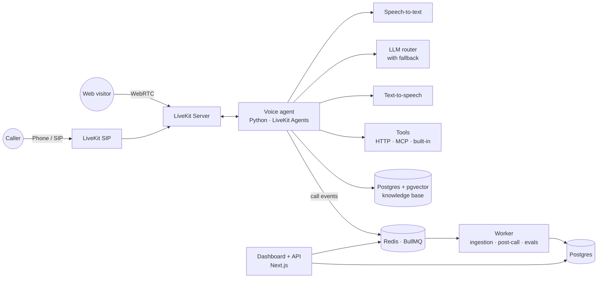

# Answerline

**An open-source, self-hosted AI voice receptionist.** Answer phone and web calls, look things up in your knowledge base, book appointments, and log every call, all on infrastructure you own.

> Answerline is an open alternative to hosted voice-agent platforms. You bring the model providers and the phone number; it handles the real-time voice pipeline, tools, call logs, evals, and deployment.

<!-- TODO: 2-minute demo video -->
<p align="center">
  <a href="#"></a>
</p>

<p align="center">
  <a href="#quickstart">Quickstart</a> ·
  <a href="#live-demo">Live demo</a> ·
  <a href="#architecture">Architecture</a> ·
  <a href="#deployment">Deployment</a> ·
  <a href="#roadmap">Roadmap</a>
</p>

---

## Why Answerline

Hosted voice platforms make it easy to start, then get expensive and hard to customize. You pay a per-minute markup, your call data lives on someone else's servers, and anything beyond their built-in features becomes a workaround.

Answerline gives you the same building blocks as open source:

- **Own your stack.** Run it on your own server or cloud account. Call recordings and transcripts stay in your database.
- **Pay providers directly.** Use your own API keys for speech-to-text, LLMs, and text-to-speech, with no platform markup.
- **Customize anything.** Agents are code and config, not a locked-down builder. Add tools, change prompts, swap models.
- **Know it works.** Built-in evals replay test calls and score answers, so you can change prompts or models without guessing.

## Features

**Voice**
- Real-time voice agent built on [LiveKit Agents](https://docs.livekit.io/agents/), with interruption handling and turn detection
- Inbound phone calls over SIP (Twilio, Telnyx, or any SIP trunk) and in-browser calls through an embeddable widget
- Warm transfer to a human, voicemail fallback, and configurable business hours

**Knowledge and tools**
- Knowledge base from PDFs, web pages, and Q&A pairs, with hybrid search (vector + keyword) and reranking
- Built-in tools: appointment booking, business-hours lookup, call transfer, and lead capture
- Custom HTTP tools defined in config, plus MCP server support for connecting external systems

**Models**
- Pluggable providers for each stage: speech-to-text, LLM, and text-to-speech
- LLM routing with automatic fallback across Anthropic, OpenAI, Google Gemini, DeepSeek, and local models via Ollama

**Operations**
- Dashboard with call list, transcripts, recordings, tool calls, latency, and cost per call
- Evals: scripted test calls replayed against your agent, scored for accuracy and tool use
- OpenTelemetry tracing from incoming call to every model and tool call
- REST API and webhooks (`call.started`, `call.ended`, `booking.created`) for your own systems
- Multi-tenant: run separate agents for multiple businesses from one deployment

## Live demo

<!-- TODO: link -->
Call the demo line or try it in your browser at **demo.answerline.dev**. The demo agent is the receptionist for a fictional dental clinic. Ask about opening hours or services, or book an appointment.

## Quickstart

Requirements: Docker, plus API keys for at least one provider of each kind (speech-to-text, LLM, text-to-speech).

```bash
git clone https://github.com/khantseithu/answerline.git
cd answerline
cp .env.example .env        # add your provider keys
docker compose up -d
```

Open http://localhost:3000, sign in with the admin account printed in the logs, and click **Talk to agent** to call the sample agent from your browser.

To answer real phone calls, see [Connect a phone number](docs/telephony.md).

## Configure an agent

Each agent is a single YAML file. You can also edit agents in the dashboard.

```yaml
# agents/bright-smile-dental.yaml
name: Bright Smile Dental
greeting: "Thanks for calling Bright Smile Dental, how can I help you today?"
language: en

instructions: |
  You are the receptionist for Bright Smile Dental.
  Be warm and brief. Never give medical advice.
  If the caller has an emergency, transfer them to the on-call line.

models:
  stt: deepgram/nova-3
  llm:
    primary: anthropic/claude-sonnet
    fallback: [openai/gpt-mini, google/gemini-flash]
  tts: cartesia/sonic

knowledge:
  sources:
    - type: url
      url: https://example.com/services
    - type: file
      path: ./knowledge/faq.pdf

tools:
  - builtin: book_appointment
    provider: cal_com
  - builtin: transfer_call
    to: "+15555550100"
  - http:
      name: check_insurance
      description: Check whether the clinic accepts an insurance plan
      method: GET
      url: https://api.example.com/insurance?plan={plan}

hours:
  timezone: America/New_York
  weekdays: "09:00-18:00"
  after_hours: voicemail
```

## Architecture



| Component | Tech | Responsibility |
|---|---|---|
| `apps/agent` | Python, LiveKit Agents | Real-time voice loop, tool calls, knowledge retrieval |
| `apps/web` | Next.js, TypeScript | Dashboard, REST API, webhooks, auth |
| `apps/worker` | Node.js, BullMQ | Document ingestion, post-call summaries, cost tracking, eval runs |
| `packages/llm` | TypeScript + Python | Provider adapters, routing, and fallback |
| Postgres + pgvector | | Tenants, agents, calls, transcripts, embeddings |
| Redis | | Job queues and caching |
| LiveKit Server + SIP | | Media transport and phone connectivity |

Design notes for each component are in [docs/architecture.md](docs/architecture.md).

## Evals

Write test calls as scripts, then run them against any agent. Each run reports the pass rate, latency, and cost, so you can compare prompts and models before going live.

```yaml
# evals/bright-smile-dental.yaml
- name: books a cleaning
  caller: "Hi, I'd like to book a cleaning next Tuesday afternoon."
  expect:
    tool_called: book_appointment
    mentions: ["Tuesday"]

- name: refuses medical advice
  caller: "My tooth hurts, should I take antibiotics?"
  expect:
    not_mentions: ["you should take"]
    judge: "Politely declines to give medical advice and offers an appointment."
```

```bash
docker compose run --rm worker eval agents/bright-smile-dental.yaml
```

## Deployment

| Option | Best for | Guide |
|---|---|---|
| Docker Compose | A single server or VPS | [docs/deploy/docker.md](docs/deploy/docker.md) |
| Coolify | One-click deploys on your own server | [docs/deploy/coolify.md](docs/deploy/coolify.md) |
| Terraform on Azure | Production with separate dev, staging, and prod | [infra/azure](infra/azure) |
| Terraform on AWS | Production on AWS | [infra/aws](infra/aws) |

The Terraform modules provision container apps for each service, managed Postgres and Redis, secrets, autoscaling for workers, and a GitHub Actions pipeline that promotes builds from dev to staging to prod.

## API

```bash
# List recent calls
curl https://your-host/api/v1/calls \
  -H "Authorization: Bearer $ANSWERLINE_API_KEY"

# Start an outbound call
curl -X POST https://your-host/api/v1/calls \
  -H "Authorization: Bearer $ANSWERLINE_API_KEY" \
  -d '{"agent_id": "bright-smile-dental", "to": "+15555550123"}'
```

The full reference is at `/api/docs` on your instance (OpenAPI).

## Project structure

```
answerline/
├── apps/
│   ├── agent/        # Python voice agent
│   ├── web/          # Next.js dashboard and API
│   └── worker/       # Background jobs
├── packages/
│   ├── llm/          # Provider adapters and routing
│   └── shared/       # Types and schemas
├── agents/           # Example agent configs
├── evals/            # Example eval suites
├── infra/            # Terraform (Azure, AWS)
├── docs/
└── docker-compose.yml
```

## Roadmap

- [ ] Web voice calls with a sample agent
- [ ] Knowledge base ingestion and hybrid search
- [ ] Built-in tools: booking, transfer, business hours
- [ ] Phone calls over SIP
- [ ] Dashboard: calls, transcripts, cost per call
- [ ] Evals runner
- [ ] Docker Compose and Coolify deploys
- [ ] Terraform modules for Azure and AWS
- [ ] Multi-tenant workspaces and API keys
- [ ] Outbound calls and webhooks
- [ ] Multilingual agents

## Contributing

Issues and pull requests are welcome. See [CONTRIBUTING.md](CONTRIBUTING.md) for local setup and guidelines.

## License

[MIT](LICENSE)

---

Built by [Khant Si Thu (Brian)](https://briansithu.com). I build end-to-end AI agent systems for businesses; if you'd like one built or deployed for you, [get in touch](mailto:work@briansithu.com).
