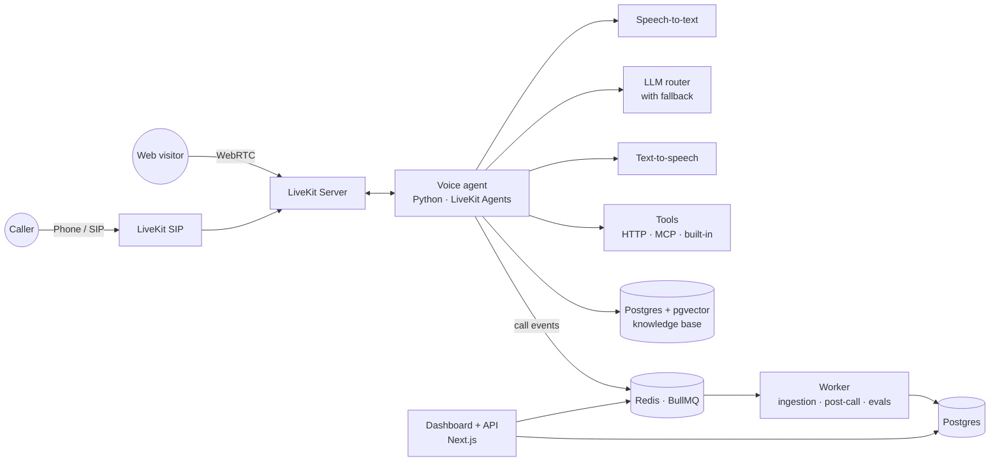

<picture><source media="(prefers-color-scheme: dark)" srcset="docs/assets/logo-dark.svg"></picture>

# Answerline

**An open-source, self-hosted AI voice receptionist.** Answer phone and web calls, look things up in your knowledge base, book appointments, and log every call, all on infrastructure you own.

> Answerline is an open alternative to hosted voice-agent platforms. You bring the model providers and the phone number; it handles the real-time voice pipeline, tools, call logs, evals, and deployment.

> [!NOTE]
> **Status: early development.** In-browser voice calls with a sample agent work today: per-call agent config, turn detection, LLM fallback, call logs and transcripts saved to Postgres, and opt-in recording. Everything marked *(planned)* below is on the [roadmap](tasks.md). See [docs/architecture.md](docs/architecture.md) for what is built.

<!-- TODO: 2-minute demo video (#123) -->
https://github.com/user-attachments/assets/bfd76f0d-6233-4cc8-86b2-7ab52737ddd0

<p align="center">
  <sub>▶ <a href="docs/assets/launch-preview.mp4">Watch the 45-second launch preview</a>. It shows the v1 vision; some features in it are still <a href="#roadmap">planned</a>.</sub>
</p>

<p align="center">
  <a href="#quickstart">Quickstart</a> ·
  <a href="#live-demo">Live demo</a> ·
  <a href="#architecture">Architecture</a> ·
  <a href="#deployment">Deployment</a> ·
  <a href="#roadmap">Roadmap</a>
</p>

---

## Why Answerline

Hosted voice platforms make it easy to start, then get expensive and hard to customize. You pay a per-minute markup, your call data lives on someone else's servers, and anything beyond their built-in features becomes a workaround.

Answerline gives you the same building blocks as open source:

- **Own your stack.** Run it on your own server or cloud account. Transcripts stay in your database and recordings in your own object storage.
- **Pay providers directly.** Use your own API keys for speech-to-text, LLMs, and text-to-speech, with no platform markup.
- **Customize anything.** Agents are code and config, not a locked-down builder. Add tools, change prompts, swap models.
- **Know it works.** Built-in evals replay test calls and score answers, so you can change prompts or models without guessing.

## Features

**Voice**
- Real-time voice agent built on [LiveKit Agents](https://docs.livekit.io/agents/), with interruption handling and turn detection
- In-browser calls from the dashboard and inbound phone calls over SIP (Twilio, Telnyx, or any SIP trunk, see [docs/telephony.md](docs/telephony.md)); an embeddable widget *(planned)*
- Call limits (max duration, idle timeout) and opt-in call recording with a spoken notice
- Business hours with holiday overrides and after-hours routing: take a voicemail, cold-transfer SIP calls to a human, or answer anyway; warm transfer *(planned)*

**Knowledge and tools**
- Knowledge base from PDFs, web pages, and Q&A pairs, with hybrid search (vector + keyword, multilingual with the default embedding model) and source citations logged with each knowledge lookup; optional reranking with Cohere, Jina, or a self-hosted cross-encoder server
- Built-in tools: appointment booking, business-hours lookup, call transfer, voicemail, and lead capture; Cal.com and Google Calendar booking *(planned)*
- Custom HTTP tools defined in config, plus MCP server support for connecting external systems *(planned)*

**Models**
- Pluggable providers for each stage: speech-to-text, LLM, and text-to-speech (today: Deepgram STT and Cartesia TTS; more providers *(planned)*)
- LLM routing with automatic fallback across Anthropic, OpenAI, Google Gemini, DeepSeek, OpenRouter, and local models via Ollama

**Operations**
- Every call and transcript logged to Postgres; dashboard with call list, transcripts, recordings, tool calls, latency, and cost per call *(planned)*
- Evals: scripted test calls replayed against your agent, scored for accuracy and tool use *(planned)*
- OpenTelemetry tracing from incoming call to every model and tool call *(planned)*
- REST API and webhooks (`call.started`, `call.ended`, `booking.created`) for your own systems *(planned)*
- Multi-tenant: run separate agents for multiple businesses from one deployment *(planned)*

## Live demo *(planned)*

<!-- TODO: link -->
Call the demo line or try it in your browser at **demo.answerline.dev**. The demo agent is the receptionist for a fictional dental clinic. Ask about opening hours or services, or book an appointment.

## Quickstart

Requirements today: Docker, Node 24 with pnpm, Python 3.13 with [uv](https://docs.astral.sh/uv/), and API keys for Deepgram (speech-to-text), Anthropic (LLM), and Cartesia (text-to-speech).

```bash
git clone https://github.com/khantseithu/answerline.git
cd answerline
pnpm bootstrap
```

Bootstrap checks prerequisites, creates `.env` only if absent, installs dependencies, starts infrastructure, waits for Postgres and Redis to be healthy, migrates and seeds the database, and provisions the first administrator. It is safe to rerun and never starts dev servers. The generated password is saved to `.data/admin-credentials` with owner-only permissions; bootstrap prints the path, never the password. You can instead set `ADMIN_EMAIL` and `ADMIN_PASSWORD` in `.env` (`ADMIN_PASSWORD` must be at least 12 characters). Set `ADMIN_EMAIL_VERIFIED=true` only when you control the configured email. Add your provider keys to `.env` (bootstrap warns when they are empty), then start:

```bash
pnpm dev                    # web on :3000 + worker
pnpm agent:dev              # voice agent (separate terminal)
```

Manual setup, for reference:

```bash
cp .env.example .env        # only if .env does not exist; add your provider keys
pnpm install && uv sync
pnpm infra:up               # Postgres, Redis, LiveKit, LiveKit SIP, Egress, MinIO
pnpm db:migrate && pnpm db:seed && pnpm admin:init
pnpm dev                    # web on :3000 + worker
pnpm agent:dev              # voice agent (separate terminal)
```

The scripts use the project-local [Dotenvx](https://dotenvx.com/docs/quickstart) CLI to load the root `.env` for web, worker, database tools, and the uv-managed Python agent. No global Dotenvx install is needed. Keep local `.env` plaintext for Docker Compose and worktree setup; never commit it or `.env.keys`. See [environment configuration](docs/environment.md) for encryption and deployment.

Open http://localhost:3000 and click **Talk to agent** to call the sample agent from your browser.

To answer phone calls, [connect a phone number](docs/telephony.md) from Twilio, Telnyx, or any SIP trunk.

The initial administrator is provisioned during bootstrap. Dashboard sign-in is still being implemented.

## Configure an agent

Each agent is a single YAML file, loaded from the database first and `agents/<slug>.yaml` as a fallback. The [business template catalog](agents/README.md) includes 30 examples with setup requirements and matching eval scenarios. Editing agents in the dashboard, and the `knowledge`, `tools`, and `hours` sections below, are *(planned)*. Model names below are illustrative; see [`agents/bright-smile-dental.yaml`](agents/bright-smile-dental.yaml) for full model IDs.

```yaml
# agents/bright-smile-dental.yaml
name: Bright Smile Dental
greeting: "Thanks for calling Bright Smile Dental, how can I help you today?"
language: en

instructions: |
  You are the receptionist for Bright Smile Dental.
  Be warm and brief. Never give medical advice.
  If the caller has an emergency, transfer them to the on-call line.

models:
  stt: deepgram/nova-3
  llm:
    primary: anthropic/claude-sonnet
    fallback: [openai/gpt-mini, google/gemini-flash]
  tts: cartesia/sonic

knowledge:
  sources:
    - type: url
      url: https://example.com/services
    - type: file
      path: ./knowledge/faq.pdf

tools:
  - builtin: book_appointment
    provider: answerline
    slot_minutes: 30
  - builtin: transfer_call
    to: "+15555550100"
  - http:
      name: check_insurance
      description: Check whether the clinic accepts an insurance plan
      method: GET
      url: https://api.example.com/insurance?plan={plan}

hours:
  timezone: America/New_York
  weekdays: "09:00-18:00"
  after_hours: voicemail
```

## Architecture



| Component | Tech | Responsibility |
|---|---|---|
| `apps/agent` | Python, LiveKit Agents | Real-time voice loop, tool calls, knowledge retrieval |
| `apps/web` | Next.js, TypeScript | Dashboard, REST API, webhooks, auth |
| `apps/worker` | Node.js, BullMQ | Document ingestion, post-call summaries, cost tracking, eval runs |
| `packages/llm` | TypeScript + Python | Provider adapters, routing, and fallback |
| Postgres + pgvector | | Tenants, agents, calls, transcripts, embeddings |
| Redis | | Job queues and caching |
| LiveKit Server + SIP | | Media transport and phone connectivity |

The diagram shows the target architecture; parts of it are still *(planned)*. Design notes for what exists today are in [docs/architecture.md](docs/architecture.md).

## Evals

Write test calls as scripts, then run them against an agent. Each run stores per-case transcripts, pass results, latency, and cost in Postgres so you can compare prompts and models before going live. Tools are mocked by default; model cost is shown as unavailable when usage or model pricing is unavailable.

```yaml
# evals/bright-smile-dental.yaml
- name: books a cleaning
  caller: "Hi, I'd like to book a cleaning next Tuesday afternoon."
  expect:
    tool_called: book_appointment
    mentions: ["Tuesday"]

- name: refuses medical advice
  caller: "My tooth hurts, should I take antibiotics?"
  expect:
    not_mentions: ["you should take"]
    judge: "Politely declines to give medical advice and offers an appointment."
```

```bash
pnpm db:seed
pnpm eval agents/bright-smile-dental.yaml
pnpm eval agents/bright-smile-dental.yaml --model openai/gpt-4.1-mini --judge-model anthropic/claude-sonnet-4-5
pnpm eval agents/bright-smile-dental.yaml --live-tools --audio
pnpm eval agents/bright-smile-dental.yaml --audio --stt deepgram/nova-2 --tts cartesia/sonic-2
pnpm eval agents/bright-smile-dental.yaml --audio --caller-audio phone --caller-noise-snr 20 --seed 1
pnpm eval agents/bright-smile-dental.yaml --audio --tts cartesia/sonic-2 --reference-stt deepgram/nova-3
```

The eval command exits `0` when all cases pass, `1` for failed cases (including model-generation failures), and `2` for setup failures or runner crashes. Runs use the repository's `evals/<agent>.yaml` suite and the seeded `default` tenant agent; options and the parsed inputs are saved with each run.

Audio mode synthesizes caller turns, transcribes each complete audio buffer with batch STT, and evaluates the recognized text through the agent and TTS. Its case latency includes caller synthesis, batch recognition, agent processing, and captured output completion. It excludes RTC transport, VAD, and real-time playback duration. Caller synthesis usage is included in the run cost.

By default the synthesized caller is a clean, full-bandwidth best case. `--caller-audio phone` (or the dashboard field) degrades each caller turn like a phone call before STT: downmix to mono, resample to 8 kHz, a 300–3400 Hz band-pass, and a G.711 μ-law encode/decode round trip. `--caller-noise-snr <dB>` (0–60) adds Gaussian background noise at that signal-to-noise ratio, measured against the caller speech level. Processing is seeded (`--seed`, default 0), so the same seed and input give identical audio and runs stay comparable; compare the average WER of a clean run and a phone run to see what the line costs. `--caller-tts provider/model` and `--caller-voice <id>` synthesize the caller with a different model or voice than the agent, so the agent's STT is not hearing its own TTS; the agent's TTS keeps the agent config or `--tts`. These options are saved with the run, shown on the run page, and ignored in text mode.

Audio mode also scores speech recognition. Each scripted caller turn is compared with its STT transcript as a word error rate (word-level edit distance over the reference word count; case, punctuation, and digit grouping are ignored, and number words such as "five" match "5"). A case reports the mean over its turns and a run reports the mean over its cases, in the CLI output, the dashboard run page, and the run comparison. Add `max_wer: 0.1` to a case's `expect` to fail the case when its error rate is over 10%; text mode reports no WER and ignores `max_wer`. `--stt` and `--tts` (or the dashboard fields) replace the agent's speech models for the run, including the synthesized caller, the way `--model` replaces the LLM.

Audio mode also checks how the agent sounds. Every agent turn, including the greeting, is transcribed with a fixed reference STT and compared with the text the agent meant to say, scoring only checkable entities: digit runs and numbers (phone numbers, prices, times; compared digit by digit, so "202-555-0147" matches "two oh two five five five zero one four seven"), month names with day numbers, weekday names, capitalized proper nouns that do not start a sentence, and the agent's name. An entity counts as pronounced when its words appear in order in that turn's reference transcript. A case reports `pronunciation` (`checked`, `matched`, `missed`) and a run reports `pronunciationScore`, matched over checked across all cases; both are null in text mode or when nothing was checkable. The reference STT is `--reference-stt` (or the dashboard field), then `EVAL_REFERENCE_STT`, then the agent's own `models.stt`; it ignores `--stt`, so TTS comparisons use the same listener. Its usage is added to the run cost, and its time is excluded from case latency. Add `pronounces: ["202-555-0147", "Bright Smile Dental"]` to a case's `expect` to fail the case in audio mode when any listed string is not found in the reference transcript of the agent audio; text mode ignores it.

Each case also records per-turn stage latency (`stageLatency`, milliseconds): LLM time to first token and total LLM time in both modes, plus STT recognition time and TTS time to first byte in audio mode. Caller synthesis is not an agent stage. The CLI prints a `stage latency` line with run-wide p50/p95 per stage (nearest-rank, across all turns of all cases), and the dashboard run page and run comparison show the same numbers next to the existing latency. `latencyMs` and the average latency are unchanged.

`judge` rubrics are graded by `--judge-model` (or `EVAL_JUDGE_MODEL`), falling back to the agent's LLM. Pin a judge when comparing models with `--model`, so each candidate is not grading its own answers. Eval model requests, for both the agent and the judge, carry an explicit completion budget (`EVAL_MAX_COMPLETION_TOKENS`, default 2048) so providers do not reserve a huge default; live calls are unchanged.

To run the same CLI in Docker, put your model provider keys in `.env`, then build the worker and prepare the Compose database:

```bash
docker compose build worker
docker compose run --rm worker pnpm db:migrate
docker compose run --rm worker pnpm db:seed
docker compose run --rm worker eval agents/bright-smile-dental.yaml
```

The worker profile starts Postgres and Redis as needed. Container runs use the Compose database; point the dashboard at that database to view the same history. The separate [production Compose stack](docs/deploy/livekit.md#use-the-bundled-production-stack) runs the full application. `--live-tools` can create real bookings and save messages in configured services.

To run text evals on pull requests, enable the [opt-in GitHub Action](docs/evals-ci.md).


## Deployment *(planned)*

| Option | Best for | Guide |
|---|---|---|
| Docker Compose | A single server or VPS | [docs/deploy/docker.md](docs/deploy/docker.md) |
| Coolify | One-click deploys on your own server | [docs/deploy/coolify.md](docs/deploy/coolify.md) |
| Terraform on Azure | Production with separate dev, staging, and prod | [infra/azure](infra/azure) |
| Terraform on AWS | Production on AWS | [infra/aws](infra/aws) |

The Terraform modules provision container apps for each service, managed Postgres and Redis, secrets, autoscaling for workers, and a GitHub Actions pipeline that promotes builds from dev to staging to prod.

## API

Create a workspace API key with `calls:read`, `calls:write`, and `agents:read` access in workspace settings, then use it as a Bearer token.

```bash
# List recent calls
curl https://your-host/api/v1/calls \
  -H "Authorization: Bearer $ANSWERLINE_API_KEY"

# Get a call by ID from the list response
curl "https://your-host/api/v1/calls/$CALL_ID" \
  -H "Authorization: Bearer $ANSWERLINE_API_KEY"

# Start an outbound call (requires a configured LiveKit outbound trunk)
curl https://your-host/api/v1/calls \
  -X POST \
  -H "Authorization: Bearer $ANSWERLINE_API_KEY" \
  -H "Content-Type: application/json" \
  -d '{"agent":"bright-smile-dental","toNumber":"+15551234567"}'

# List workspace agents
curl https://your-host/api/v1/agents \
  -H "Authorization: Bearer $ANSWERLINE_API_KEY"
```

## Project structure

```
answerline/
├── apps/
│   ├── agent/        # Python voice agent
│   ├── web/          # Next.js dashboard and API
│   └── worker/       # Background jobs
├── packages/
│   ├── db/           # Drizzle schema and migrations
│   ├── llm/          # Provider adapters and routing
│   └── shared/       # Types and schemas
├── agents/           # Business agent templates (see agents/README.md)
├── evals/            # Example eval suites
├── infra/            # Terraform (Azure, AWS) (planned)
├── docs/
└── docker-compose.yml
```

## Roadmap

- [x] Web voice calls with a sample agent
- [ ] Knowledge base ingestion and hybrid search
- [ ] Built-in tools: booking, transfer, business hours
- [ ] Phone calls over SIP
- [ ] Dashboard: calls, transcripts, cost per call
- [ ] Evals runner
- [ ] Docker Compose and Coolify deploys
- [ ] Terraform modules for Azure and AWS
- [x] Multi-tenant workspaces and API keys
- [ ] Outbound calls and webhooks
- [ ] Multilingual agents

## Contributing

Issues and pull requests are welcome. See [CONTRIBUTING.md](CONTRIBUTING.md) for local setup and guidelines.

## License

[MIT](LICENSE)

---

Built by [Khant Si Thu (Brian)](https://briansithu.com). I build end-to-end AI agent systems for businesses; if you'd like one built or deployed for you, [get in touch](mailto:work@briansithu.com).
