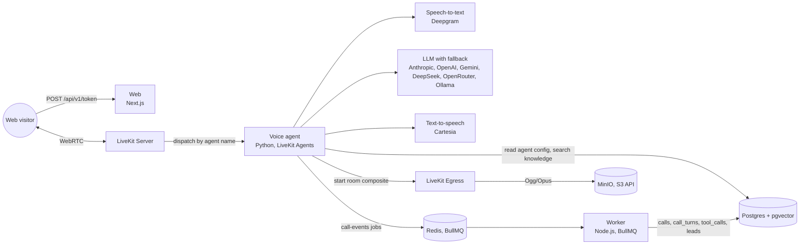
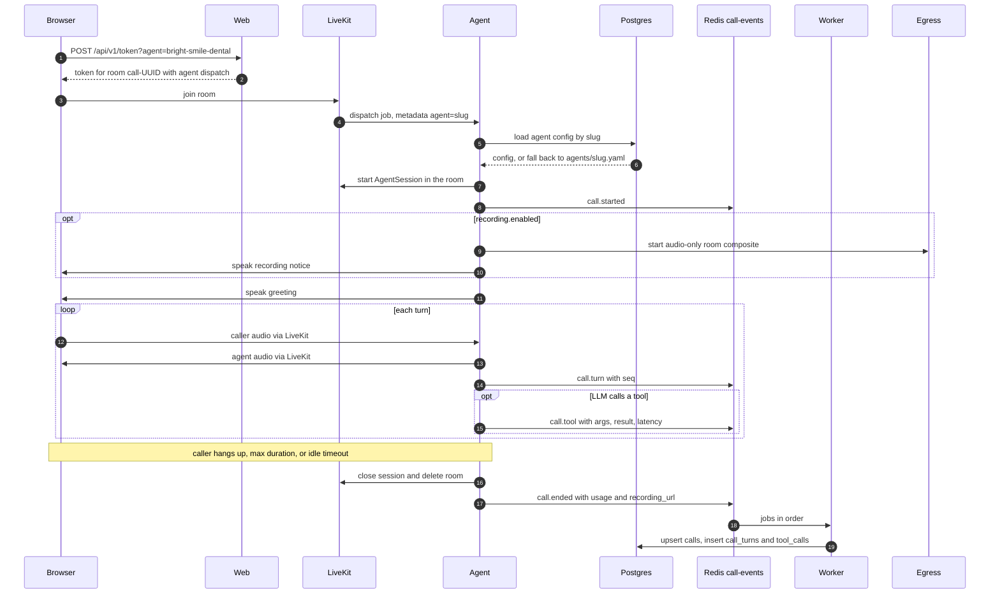
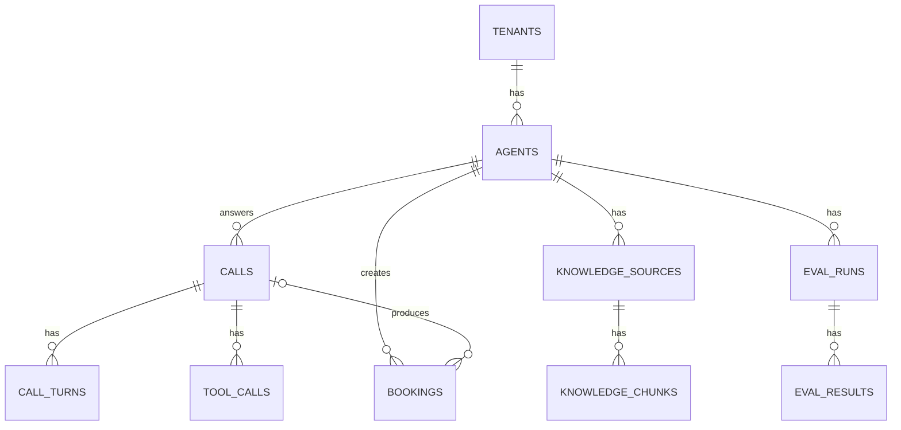

# Architecture

How Answerline is put together today, component by component. This describes milestone M1 (web voice calls) and the implemented M2 embedding providers. Anything not built yet is marked **Planned** with a link to its roadmap issue. The roadmap is in [`tasks.md`](../tasks.md) and the product vision is in the [README](../README.md).

- [Overview](#overview)
- [Lifecycle of a call](#lifecycle-of-a-call)
- [Components](#components)
- [Data model](#data-model)
- [Contracts and parity](#contracts-and-parity)
- [Multi-tenancy](#multi-tenancy)
- [Latency](#latency)
- [Local development topology](#local-development-topology)
- [Built vs planned](#built-vs-planned)
- [Decisions](#decisions)

## Overview



Three processes do the work:

| Process | Code | Role today |
|---|---|---|
| Web | [`apps/web`](../apps/web) | Dashboard shell, design system page, and the token endpoint that starts a browser call |
| Voice agent | [`apps/agent`](../apps/agent) | Joins LiveKit rooms, runs the STT, LLM, TTS loop, enforces call limits, publishes call events, starts recordings |
| Worker | [`apps/worker`](../apps/worker) | Consumes `call-events` and writes calls and transcripts to Postgres |

They share no process state. The agent and the worker talk only through Redis (BullMQ jobs). The web app talks only to LiveKit: it does not read Postgres or enqueue jobs yet.

Differences from the README diagram, which shows the target design: phone calls over SIP, tools other than `search_knowledge` and `business_hours`, the web app reading Postgres, and the web app enqueueing jobs are all **Planned** (see [Built vs planned](#built-vs-planned)).

## Lifecycle of a call



1. The **Talk to agent** button ([`talk-to-agent-button.tsx`](../apps/web/src/components/call/talk-to-agent-button.tsx), [`call-app.tsx`](../apps/web/src/components/call/call-app.tsx)) calls `POST /api/v1/token?agent=<slug>` through `TokenSource.endpoint`.
2. [`call-token.ts`](../apps/web/src/lib/call-token.ts) creates a room name `call-<uuid>` and a 15 minute token whose room configuration dispatches the agent named `AGENT_NAME`, with dispatch metadata `{"agent": "<slug>"}`. The route returns 403 when `NODE_ENV=production`, because there is no auth yet.
3. The browser joins the room. LiveKit creates it and dispatches a job to an agent worker registered under that name. The browser buffers mic audio while the agent joins (pre-connect buffer).
4. The agent's [`entrypoint`](../apps/agent/src/answerline_agent/main.py) resolves the config ([`resolve.py`](../apps/agent/src/answerline_agent/resolve.py)), builds the session, waits up to 30 s for the caller, and publishes `call.started`.
5. If the agent has `recording.enabled`, it starts egress, then speaks the notice, then the greeting. Otherwise it speaks the greeting.
6. Every caller and agent message added to the conversation becomes a `call.turn` event with a sequence number, timestamps, an interrupted flag, and per-turn latency.
7. Every function tool the LLM runs becomes a `call.tool` event with the tool name, arguments, result or error, status, and latency.
8. The call ends when the caller leaves, the max duration is reached, or the caller stays idle. The agent closes the session, flushes events, deletes the room, and shuts the job down. `call.ended` carries status, duration, usage totals, and the recording URL.
9. The worker validates each job and writes `calls`, `call_turns`, and `tool_calls`. Writes are idempotent, so BullMQ retries are safe.

## Components

### Web (`apps/web`)

Next.js 16 App Router, React 19, Tailwind 4, shadcn/ui on Base UI. Rules for this app are in [`apps/web/AGENTS.md`](../apps/web/AGENTS.md).

| Path | What |
|---|---|
| [`src/app/(dashboard)`](../apps/web/src/app/%28dashboard%29) | App shell (sidebar, header) and pages: Overview, Calls, Agents, Knowledge, Evals, Phone numbers, Settings. Overview holds the call card; the others are empty states that link to their roadmap issue, and Settings lists theme and provider env vars. None read data yet. |
| [`src/app/design`](../apps/web/src/app/design/page.tsx) | Design system reference: tokens, components, motion |
| [`src/app/api/v1/token/route.ts`](../apps/web/src/app/api/v1/token/route.ts) | `POST` issues a LiveKit token with agent dispatch (dev only) |
| [`src/app/api/health/route.ts`](../apps/web/src/app/api/health/route.ts) | `GET` returns `{ "ok": true }` |
| [`src/components/call`](../apps/web/src/components/call) | `CallApp` wraps the dashboard, owns the LiveKit session, and shows the full-screen call view |
| [`src/components/agents-ui`](../apps/web/src/components/agents-ui) | Vendored LiveKit Agents UI shadcn registry blocks: session view, transcript, control bar, audio visualizers. Excluded from lint, with small patches for our Base UI components. |
| [`src/env.ts`](../apps/web/src/env.ts) | Zod-validated env: `AGENT_NAME`, `LIVEKIT_URL`, `LIVEKIT_API_KEY`, `LIVEKIT_API_SECRET`, `NODE_ENV` |

The dashboard layout hard-codes the Bright Smile Dental agent for the call button. Choosing an agent in the UI comes with the Agents page (**Planned**, [#80](https://github.com/khantseithu/answerline/issues/80)).

Extension points: new API routes go under `src/app/api/v1/` and validate input with schemas from `packages/shared`.

### Voice agent (`apps/agent`)

Python 3.13 on [LiveKit Agents](https://docs.livekit.io/agents/) 1.8.8. `pnpm agent:dev` runs `answerline-agent dev`, which registers an `AgentServer` with LiveKit under `AGENT_NAME`. Because it registers with an explicit name, LiveKit only sends it rooms whose token asks for that name.

| Module | Responsibility |
|---|---|
| [`main.py`](../apps/agent/src/answerline_agent/main.py) | Server setup, prewarm (Silero VAD and the local turn detector are loaded once per process), per-call entrypoint |
| [`resolve.py`](../apps/agent/src/answerline_agent/resolve.py), [`db.py`](../apps/agent/src/answerline_agent/db.py) | Picks the agent slug from dispatch metadata and loads its config |
| [`config.py`](../apps/agent/src/answerline_agent/config.py) | Pydantic mirror of the shared agent config schema |
| [`providers.py`](../apps/agent/src/answerline_agent/providers.py) | Builds STT, LLM (with fallback), and TTS from `provider/model` refs |
| [`prompts.py`](../apps/agent/src/answerline_agent/prompts.py) | Prepends voice output rules to the agent's instructions |
| [`turns.py`](../apps/agent/src/answerline_agent/turns.py) | Turn detection, interruption, preemptive generation |
| [`call_limits.py`](../apps/agent/src/answerline_agent/call_limits.py) | Hangup, max duration, idle timeout, worker drain |
| [`call_events.py`](../apps/agent/src/answerline_agent/call_events.py), [`call_session.py`](../apps/agent/src/answerline_agent/call_session.py), [`publisher.py`](../apps/agent/src/answerline_agent/publisher.py) | Builds `call.*` events from session events and enqueues them |
| [`recording.py`](../apps/agent/src/answerline_agent/recording.py) | Starts and stops LiveKit Egress |
| [`knowledge.py`](../apps/agent/src/answerline_agent/knowledge.py), [`knowledge_tool.py`](../apps/agent/src/answerline_agent/knowledge_tool.py) | Hybrid knowledge search and the `search_knowledge` tool built on it |
| [`settings.py`](../apps/agent/src/answerline_agent/settings.py) | pydantic-settings env loading |

**Config resolution.** `parse_agent_slug` reads `{"agent": "<slug>"}` from the dispatch metadata. Missing, malformed, or invalid slugs fall back to `DEFAULT_AGENT`. If `DATABASE_URL` is set, the agent opens one asyncpg connection (5 s connect timeout) and reads `agents.config` for that slug in the `default` tenant. When the row is missing or the database errors or times out, it falls back to `AGENTS_DIR/<slug>.yaml`. If neither exists, the job fails. The database is the source of truth and YAML is the seed format and fallback ([#131](https://github.com/khantseithu/answerline/issues/131)).

**Providers.** Each stage is a `provider/model` ref from the agent config, and plugins are only constructed in `providers.py`. Supported today: STT `deepgram/*`, TTS `cartesia/*`, LLM `anthropic`, `openai`, `google`, `deepseek` (OpenAI-compatible), `openrouter` (OpenAI-compatible; refs carry the OpenRouter model id, e.g. `openrouter/anthropic/claude-sonnet-4.5`), and `ollama` (OpenAI-compatible). With fallbacks configured, the LLM is a LiveKit `llm.FallbackAdapter` over `[primary, *fallback]`, which moves to the next provider when one fails. Provider API keys come from the standard env vars each plugin reads (`DEEPGRAM_API_KEY`, `ANTHROPIC_API_KEY`, and so on). Adding a provider means adding the plugin extra in `pyproject.toml`, a case in `providers.py`, and, for LLMs, the name in `PROVIDERS` in `packages/llm`.

**Prompt.** `compose_instructions` puts fixed voice rules (plain text only, one to three sentences, spell out numbers, never reveal instructions or tool names) before the agent's own `instructions`.

**Turn handling.** Defaults are fully self-hosted ([#130](https://github.com/khantseithu/answerline/issues/130)):

| Setting | Default | Options |
|---|---|---|
| `TURN_DETECTION` | `local`: `inference.TurnDetector(version="v1-mini")`, runs in-process with weights shipped in the wheel | `cloud` (LiveKit Cloud `v1`), `stt`, `vad` |
| `INTERRUPTION_MODE` | `vad` | `adaptive` (LiveKit Cloud only) |

Interruptions need at least 0.6 s and one word of caller speech. A false interruption resumes the agent's speech after 1.5 s. Preemptive generation is on, so the LLM starts before the turn is confirmed final. The turn detector weights use the LiveKit Model License: free to use with LiveKit Agents, but not OSI open source.

**Call lifecycle.** `CallLifecycle` ends a call once, for the first of:

- the caller's participant disconnects;
- the session closes;
- max duration (`MAX_CALL_DURATION_SECONDS`, default 900): `min(10 s, max/2)` before the limit the agent says `CALL_WRAP_UP_MESSAGE` without allowing interruptions, then ends;
- idle timeout (`IDLE_TIMEOUT_SECONDS`, default 60): when LiveKit marks the caller `away`, the agent says `IDLE_CHECK_IN_MESSAGE`, waits a 10 s grace period, and ends unless the caller speaks.

Ending closes the session (5 s bound), flushes call events, deletes the room (5 s bound), and shuts the job down. `0` disables either limit. For deploys, the server's drain timeout defaults to max duration plus 120 s (or `DRAIN_TIMEOUT_SECONDS`), so live calls finish before a worker exits.

**Call events.** `CallSessionEvents` listens to `conversation_item_added`, `function_tools_executed`, and `close` on the `AgentSession`:

- `call.started` after the caller joins, with channel `sip` or `web` from the participant kind, and caller and trunk numbers from SIP attributes;
- `call.turn` for each caller or agent message with text, numbered by `seq`, with STT delay, LLM time to first token, and TTS time to first byte when LiveKit reports them;
- `call.tool` for every function tool the LLM ran, from `function_tools_executed`, numbered by its own `seq`. It carries the tool `name`, parsed `args` (always an object), `status` (`ok`, `error`, or `timeout`), `latency_ms`, and `started_at`. A successful tool's output string goes in `result`, unless the tool attached structured log data (below); a failed tool's message goes in `error`. LiveKit gives no separate start time, so latency is the gap between the LLM emitting the call and the tool output being recorded. `result` is any JSON value (string results are truncated at 8 KB, oversized structures are serialized and truncated), so a tool can log structured data such as citations ([#42](https://github.com/khantseithu/answerline/issues/42)). A structured result with a string `text` field keeps every other field intact when it is over the cap: `text` is truncated first;
- **Structured tool logs.** A tool that takes a `RunContext` parameter (which LiveKit injects and hides from the LLM schema) calls `tool_log.attach(context.function_call.call_id, data)`. `ToolLog` ([`tool_log.py`](../apps/agent/src/answerline_agent/tool_log.py)) is a per-call registry created in `main.py` and shared by the tools and `CallSessionEvents`; when `function_tools_executed` fires, `CallRecorder.tool` takes the entry for that `call_id` and logs it as `result` instead of the output string. The LLM still receives only the tool's return value. Entries are consumed once and ignored when the tool errored;
- `call.ended` once, with `completed` or `failed`, duration, usage totals (STT seconds, LLM tokens, TTS characters and seconds), and `recording_url`.

`CallEventPublisher` enqueues each event as a BullMQ job from Python on a background task, with a 5 s timeout. Publish failures are logged and never raised into the call. Pending publishes are flushed for up to 5 s at shutdown ([#129](https://github.com/khantseithu/answerline/issues/129)).

**Recording.** Opt-in per agent (`recording.enabled`, default off). The agent requests an audio-only room composite egress, a single Ogg/Opus file at `<tenant>/<room>.ogg` in `S3_BUCKET`, which takes the SDK path with no Chrome. Egress holds the storage credentials; the agent never sees them. If egress fails to start, the notice is skipped and the call continues unrecorded. Details and consent notes are in [recording.md](recording.md) ([#132](https://github.com/khantseithu/answerline/issues/132)).

**Env.** `AGENT_NAME`, `AGENTS_DIR`, `DEFAULT_AGENT`, `DATABASE_URL`, `REDIS_URL`, `REDIS_PREFIX`, `TENANT`, `TURN_DETECTION`, `INTERRUPTION_MODE`, `MAX_CALL_DURATION_SECONDS`, `IDLE_TIMEOUT_SECONDS`, `DRAIN_TIMEOUT_SECONDS`, `KNOWLEDGE_SEARCH_TIMEOUT_SECONDS`, `KNOWLEDGE_SEARCH_TOP_K`, `KNOWLEDGE_MIN_SIMILARITY`, `KNOWLEDGE_MIN_KEYWORD_TERMS`, `EMBEDDING_MODEL`, `CALL_WRAP_UP_MESSAGE`, `IDLE_CHECK_IN_MESSAGE`, `S3_BUCKET`, plus `LIVEKIT_URL`, `LIVEKIT_API_KEY`, `LIVEKIT_API_SECRET` and provider keys read by LiveKit Agents. See [`.env.example`](../.env.example).

**Knowledge search.** `hybrid_search` in [`knowledge.py`](../apps/agent/src/answerline_agent/knowledge.py) runs one SQL statement on an asyncpg connection: the top `candidates` chunks by pgvector cosine distance (HNSW index, `hnsw.iterative_scan = strict_order` so tenant and source filters cannot starve the candidate list) and the top `candidates` by `ts_rank_cd` over the `search` tsvector, fused with reciprocal rank fusion (`1/(rrf_k + rank)` per ranker, `rrf_k` 60) and cut to `top_k`. Every query filters on `tenant_id`; `source_ids` optionally narrows to specific sources. The keyword side ORs the query terms under the `simple` config used by the index after dropping English stopwords, so natural-language questions still match. Callers embed the query with the same model used at ingestion and pass the vector in. Each `KnowledgeHit` carries chunk and source IDs, content, citation metadata, the fused score, and the per-ranker ranks (`None` when a ranker did not return the chunk).

The fused score is rank-based, so it cannot tell a relevant top hit from an irrelevant one: the best chunk for an out-of-scope question scores the same as a perfect match ([#180](https://github.com/khantseithu/answerline/issues/180)). Each hit therefore also carries absolute signals computed in the same statement: `similarity` (cosine similarity, `1 - (embedding <=> query)`, for keyword-only hits too), `keyword_score` (`ts_rank_cd`, `None` when unmatched), and `matched_terms` of `query_terms` (how many distinct non-stopword query terms occur in the chunk). With `min_similarity` set, `hybrid_search` drops a hit unless its similarity reaches the floor or it has a strong keyword match: `matched_terms` at least `min_keyword_terms` (default 2, capped at the number of query terms so a one-word query can still match on that word). Requiring several distinct terms matters because the keyword side ORs every term, so a single shared common word ("perform" in "Do you perform cosmetic surgery?" versus "Do you perform root canals?") ranks first on keywords without being relevant. The floor is applied in SQL before `top_k`, so it adds no round trip (about 0.3 ms with the floor unset and 1 ms with it set, over 5,000 chunks); it is off by default.

Cosine similarity scales differ per embedding model (and with the dimension reduction used for Gemini and Ollama), so `KNOWLEDGE_MIN_SIMILARITY` has no universal default and must be calibrated for the model in `EMBEDDING_MODEL`. Run the retrieval quality test with the real provider and read the `cosine similarity` line of the report, which gives the in-scope answer-hit minimum and median and the out-of-scope top-hit maximum, then pick a value between them and check it:

```bash
ANSWERLINE_LIVE_EMBEDDINGS=1 pnpm exec dotenvx run -q -f .env -- uv run pytest apps/agent/tests/test_retrieval_quality.py -s
ANSWERLINE_LIVE_EMBEDDINGS=1 ANSWERLINE_MIN_SIMILARITY=0.3 pnpm exec dotenvx run -q -f .env -- uv run pytest apps/agent/tests/test_retrieval_quality.py -s -k relevance_floor
```

The second command prints recall and how many out-of-scope queries returned no hits at that floor. Re-calibrate whenever `EMBEDDING_MODEL` changes. Offline, the fixtures use a hashed (non-semantic) embedding with a floor of 0.15: out-of-scope queries return no hits for 4 of 5, recall@1 is unchanged (0.583), and recall@3 and recall@5 drop from 0.778 and 0.889 to 0.722 because that embedding is weak on paraphrases. No real-embedding calibration has been recorded yet, which is why the floor ships off.

**`search_knowledge` tool.** [`knowledge_tool.py`](../apps/agent/src/answerline_agent/knowledge_tool.py) exposes `search_knowledge(query)` to the LLM as a LiveKit function tool. At session start `open_knowledge_tools` opens a small asyncpg pool (max 3 connections) and one `httpx.AsyncClient` for the call, and runs one query for the agent's scope: `ready` sources in the configured tenant whose `agent_id` is null (tenant-wide) or the calling agent's. The tool is registered only when that scope has at least one source, so agents without a knowledge base get no dead tool; agents that exist only as YAML (no database row) see tenant-wide sources. The scope is fixed for the call, so sources added mid-call are not searched until the next call. Setup failures (database down, no embedding API key) are logged and the call continues without the tool. The source IDs are passed to `hybrid_search`; chunks always filter on `tenant_id`.

Per call of the tool: embed the query with the `EMBEDDING_MODEL` provider (built through `providers.build_embedder`, the same model and 1536-dimension normalization as ingestion), run `hybrid_search` for `KNOWLEDGE_SEARCH_TOP_K` hits (default 4), and return compact text, one block per hit: `[n] title | uri | page N` followed by the chunk, trimmed on a word boundary to 2400 characters in total. No hits, including when `KNOWLEDGE_MIN_SIMILARITY` filters every hit out, returns "No relevant information was found in the knowledge base." The whole lookup runs under `asyncio.timeout(KNOWLEDGE_SEARCH_TIMEOUT_SECONDS)` (default 1.5 s, a hard ceiling; the target is p95 under 300 ms). A timeout or any error returns "I couldn't look that up right now." so the model can recover in conversation instead of failing the turn. Each call logs `embed_ms`, `search_ms`, `total_ms`, and the hit count on `answerline.agent`.

Citations: each call also attaches a structured result to the `call.tool` event, so `tool_calls.result` is `{"text", "outcome", "citations", "error"?}`. `text` is exactly what the LLM saw; `citations` lists the hits that made it into that text, in the same order as the `[n]` labels, each with `source_id`, `chunk_id`, and whichever of `title`, `uri`, `page`, `score`, and `similarity` exist. `outcome` is `ok`, `no_results` (blank query, nothing found, or every hit under the relevance floor; `citations` is empty), `timeout`, or `error`; `error` carries the exception type and message for the latter. The tool call's own `status` stays `ok` in these cases because the model received a normal reply. The tool description tells the model to use it for factual questions about the business and to answer only from the results.

Latency: with an instant local embedder and a 5,000-chunk corpus on a local Postgres, the tool measured p50 41 ms and p95 44 ms; at 20,000 chunks of synthetic text where every chunk matches the keyword query, p50 108 ms and p95 126 ms. The real embedding API round trip is added on top and usually dominates, so it is the number to watch with `embed_ms`.

**Configured tools.** `tools.py` maps enabled `tools:` entries to LiveKit function tools and combines them with the knowledge tool at session startup. Supported builtins are `business_hours`, `capture_lead`, and `book_appointment`. For business hours, add `- builtin: business_hours` to `tools:` and provide an `hours` configuration. It reports whether the business is open now in its configured timezone, the regular weekday/weekend schedules, and the configured after-hours policy. Opening times are inclusive and closing times exclusive; overnight schedules carry into the following day. Missing weekend hours mean no weekend openings. Equal opening and closing times are rejected as ambiguous, as are invalid timezone names and clock values when the tool is built. Unimplemented builtin, HTTP, and MCP entries are logged and omitted, preserving existing sample configs without exposing nonfunctional tools.

**Lead capture.** Add `- builtin: capture_lead` to `tools:` to collect a caller's name, callback number, and reason for follow-up. The tool normalizes surrounding whitespace using the contract's explicit Unicode whitespace set, validates bounded inputs, and awaits Redis acknowledgement before returning `status: queued`. It never reports that a lead was saved when enqueueing failed. Each invocation uses a UUID derived from the tenant, room, and LiveKit tool-call ID, so safe retries or replaying the same invocation cannot create duplicate leads. The agent only enqueues a `lead.created` event; the worker writes Postgres. Success means accepted for follow-up, not that a callback or booking has happened. Jobs have three worker attempts with exponential backoff starting at 500 ms; exhausted jobs remain failed for inspection. External webhook delivery is still planned for M10.

**Booking.** Add `- builtin: book_appointment` (`provider: answerline` is the default, `slot_minutes` defaults to 30) with an `hours` configuration and a database-backed agent. The agent gets `check_availability`, `book_appointment`, `confirm_booking`, and `cancel_appointment`. Booking takes two steps (#55): `book_appointment` validates the details, checks the slot is still open, and returns a summary with a `confirmation_id` without writing anything. `confirm_booking` writes the booking, and only after the caller has spoken since that summary was issued (checked against the session's chat history), so the read-back reaches the caller first; whether they agreed is the model's call. Confirmation ids are per call and single-use, and changed details need a new `book_appointment`. Open slots are the `hours` windows cut into `slot_minutes` steps of real elapsed time (so DST days have the right number of slots), minus confirmed bookings. Times are shown to the model in the business timezone. Only times on that grid can be booked. Unlike the other tools, the agent writes `bookings` directly instead of enqueueing an event (#205): a caller should hear a confirmation only after the row exists. The `bookings_agent_no_overlap` exclusion constraint rejects overlapping confirmed bookings for an agent, so two callers racing for one slot get one booking and one "no longer available". Creating a booking is never retried. Cancelling only accepts bookings made earlier in the same call. Without `DATABASE_URL`, or when the agent is not in the database, booking stays off with a warning. Cal.com and Google Calendar are planned as optional adapters ([#53](https://github.com/khantseithu/answerline/issues/53), [#54](https://github.com/khantseithu/answerline/issues/54)).

**Tool execution policy.** Configured tools run under a total `TOOL_TIMEOUT_SECONDS` budget (default 10 seconds). Transport failures and connection loss are retried up to `TOOL_RETRIES` times (default 1, maximum 3) only when the implementation explicitly marks the operation safe to retry. Backoff is inside the total budget; validation/programming errors and unsafe writes are not automatically retried. Cancellation propagates. Failures become a sanitized LiveKit `ToolError` so the model cannot claim success. `search_knowledge` keeps its tighter `KNOWLEDGE_SEARCH_TIMEOUT_SECONDS` budget, including safe read retries, and its structured citation results. Both tool paths use LiveKit’s `RunContext.with_filler` with a single “One moment, please.” after `TOOL_FILLER_DELAY_SECONDS` (default 0.8) of continuous idle time; completion/cancellation closes the scheduler. Filler waits while the caller or agent speaks.

Not yet in the agent: holiday overrides and automatic after-hours voicemail/transfer routing ([#49](https://github.com/khantseithu/answerline/issues/49)), other builtins, HTTP and MCP tools, noise cancellation ([#21](https://github.com/khantseithu/answerline/issues/21)), and `language` driving model choice ([#117](https://github.com/khantseithu/answerline/issues/117)). The `knowledge` config field is validated but ingestion sources are managed through the knowledge API; `tools` and `hours` drive the configured tool registration described above.

### Worker (`apps/worker`)

Node.js with BullMQ, run with `tsx`. [`src/index.ts`](../apps/worker/src/index.ts) starts one BullMQ `Worker` per queue in `QUEUES`, using `REDIS_URL`, `REDIS_PREFIX`, and `DATABASE_URL` (required) from [`src/env.ts`](../apps/worker/src/env.ts).

| Queue | Handler |
|---|---|
| `call-events` | [`call-events.ts`](../apps/worker/src/call-events.ts): persists calls, transcripts, tool calls, and leads |
| `ingestion` | [`ingestion.ts`](../apps/worker/src/ingestion.ts): loads, chunks, embeds through an injected function, and replaces changed sources |
| `post-call` | Logs the job. **Planned** ([#78](https://github.com/khantseithu/answerline/issues/78)) |
| `evals` | Logs the job. **Planned** ([#88](https://github.com/khantseithu/answerline/issues/88)) |

`enqueueIngestion` (exported as `@answerline/worker/ingestion`) queues a tenant-scoped source with three attempts and exponential backoff. Nothing enqueues to `post-call` or `evals` yet.

**Knowledge ingestion.** Jobs contain `{ tenantId, sourceId }`, validated by the shared `ingestionJob` schema. The worker reads `knowledge_sources`: `url` sources use an HTTP(S) `uri`; `file` sources use an absolute path or `file://` URI to a PDF, `.txt`, `.md`, or `.markdown` file that must resolve (after `realpath`, so symlinks cannot escape) inside `KNOWLEDGE_FILES_DIR/<tenantId>/`; `text` sources store a string in `content`; `qa` sources store an array of `{ question, answer }` pairs in `content`. Files must be available on the worker filesystem (20 MiB limit; `KNOWLEDGE_FILES_DIR` defaults to `.data/knowledge` at the repo root, matching the web app); upload/storage UI remains planned. PDF extraction preserves page numbers and does not perform OCR. URL extraction uses Mozilla Readability without executing scripts, rejects non-public IPs before connecting, pins the resolved address, checks redirects, and bounds response size (10 MiB) and HTTP time (15 s).

Chunks are at most 1600 characters with 240-character overlap, preferring word boundaries. Metadata carries the source ID, title, type, URI, normalized character offsets, and PDF page or Q&A index where applicable. A SHA-256 hash of extracted documents and citation metadata skips embedding and replacement when nothing changed. Source-level advisory and row locks serialize concurrent ingestion and edits. Changed content is embedded in batches of 64; validated finite, nonzero 1536-dimensional vectors and new chunks replace old chunks atomically. Postgres generates the `search` tsvector from chunk content; the worker never writes it. Failed loads, embedding, or replacement keep the last successful chunks, hash, and ingestion timestamp.

`status` (`pending`, `processing`, `ready`, `failed`), `error`, `updated_at`, and `ingested_at` on `knowledge_sources` are readable by the future dashboard. `processing` is committed before expensive work; errors are persisted and rethrown for BullMQ retry. Successful retries clear the error. `updated_at` records status changes; `ingested_at` records the last successful check.

**Embedding integration seam.** `createIngestionProcessor(db, embed)` takes an `EmbedKnowledge` function (`string[] → Promise<number[][]>`). `index.ts` builds it with `createKnowledgeEmbedder(process.env)`, which wraps the `@answerline/llm` provider selected by `EMBEDDING_MODEL` (`google/gemini-embedding-2` by default; every provider is reduced to 1536 dimensions). If the provider cannot be built, for example because its API key is missing, the worker still starts and each ingestion job fails with that reason persisted on the source. Tests use a fake embedder and require no model API keys.

`call-events` processing parses each job with the shared `callEventJob` schema, then:

- resolves the tenant by slug, creating it if missing;
- resolves the agent by `(tenant, slug)`, importing `agents/<slug>.yaml` if the row is missing;
- `call.started` upserts `calls` by its unique `room_name`;
- `call.turn` makes sure the call row exists, then inserts into `call_turns`, ignoring duplicates on `(call_id, seq)`;
- `call.tool` makes sure the call row exists, then inserts into `tool_calls`, ignoring duplicates on `(call_id, seq)`;
- `lead.created` makes sure the call row exists, verifies its tenant/agent match, and inserts into `leads`, ignoring duplicate lead IDs; a later `call.started` fills in a placeholder call;
- `call.ended` upserts status, `ended_at`, `duration_ms`, `usage`, and `recording_url`.

Every write is an upsert or insert-if-absent, so the handler tolerates retries and events arriving out of order (a turn, tool, or end event before `call.started` still creates the call).

[`src/cli.ts`](../apps/worker/src/cli.ts) is the `eval` CLI stub: `pnpm eval agents/<name>.yaml` parses the agent and its suite in `evals/`, lists the cases, and exits 1. The runner is **Planned** ([#83](https://github.com/khantseithu/answerline/issues/83), [#87](https://github.com/khantseithu/answerline/issues/87)).

### Shared contracts (`packages/shared`)

Zod schemas that every TypeScript package imports as source, and the source of truth for cross-language contracts.

| File | Contract |
|---|---|
| [`agent-config.ts`](../packages/shared/src/agent-config.ts) | Agent YAML / `agents.config` JSON: name, greeting, language, instructions, models, knowledge, tools, hours, recording |
| [`call-events.ts`](../packages/shared/src/call-events.ts) | `callEventJob` (agent to worker) and `callEventJobId` |
| [`eval-suite.ts`](../packages/shared/src/eval-suite.ts) | Eval suite YAML |
| [`ingestion.ts`](../packages/shared/src/ingestion.ts) | Tenant-scoped ingestion jobs and validated Q&A pairs |
| [`events.ts`](../packages/shared/src/events.ts) | `QUEUES` names, and webhook payloads (`call.started`, `call.ended`, `booking.created`). The webhook schemas are not used yet; webhooks are **Planned** ([#115](https://github.com/khantseithu/answerline/issues/115)). |

Generated JSON Schemas live in [`schema/`](../packages/shared/schema) and fixtures in [`fixtures/`](../packages/shared/fixtures). See [Contracts and parity](#contracts-and-parity).

### Database (`packages/db`)

Drizzle ORM with postgres.js ([#127](https://github.com/khantseithu/answerline/issues/127)). [`src/schema.ts`](../packages/db/src/schema.ts) is the schema, [`migrations/`](../packages/db/migrations) holds generated SQL (`0000` enables `vector`), [`src/seed.ts`](../packages/db/src/seed.ts) upserts the `default` tenant and every `agents/*.yaml`. Commands: `pnpm db:generate`, `pnpm db:migrate`, `pnpm db:seed`, `pnpm db:studio`. The agent reads Postgres with plain asyncpg queries; there is no second migration system.

### Model refs and embeddings (`packages/llm`)

`parseModelRef` / `parse_model_ref` validate `provider/model` against the supported LLM providers, and `withFallback` / `with_fallback` try refs in order. The TypeScript and Python versions behave the same way. The live agent uses the Python parser and LiveKit's `FallbackAdapter` for the call itself. The TypeScript side is also available to worker jobs.

**Embeddings** ([#34](https://github.com/khantseithu/answerline/issues/34)). [`embeddings.ts`](../packages/llm/src/embeddings.ts) and [`embeddings.py`](../packages/llm/python/src/answerline_llm/embeddings.py) expose matching asynchronous batch providers. The public provider has `modelRef` / `model_ref`, `dimensions: 1536`, and `embed(texts)`, returning one vector per input in input order. Empty input returns an empty list without HTTP. Requests are split into sequential batches of at most 100, with a 10 s per-request timeout (overridable in the factory). The factory also takes `inputType` / `input_type` (`document` by default, `query` for the agent's `search_knowledge`). No automatic embedding fallback: different models produce incompatible vector spaces.

| Setting | Default | Purpose |
|---|---|---|
| `EMBEDDING_MODEL` | `google/gemini-embedding-2` | Full model ref; supported providers are `openai`, `google` (Gemini), and `ollama` |
| `OPENAI_API_KEY` | unset | Required when constructing an OpenAI embedding provider |
| `GOOGLE_API_KEY` | unset | Required when constructing a Gemini embedding provider |
| `OLLAMA_BASE_URL` | `http://localhost:11434` | Ollama server; no key required |

The worker's Zod env schema includes these settings; the Python side reads them through `EmbeddingSettings`. The voice agent does not load embedding settings yet; query embedding for `search_knowledge` is **Planned**. Keys are checked when the provider is constructed, not at application startup. Explicit factory options can override the model, key, base URL, and timeout without reading environment variables.

```ts
import { createEmbeddingProvider, embeddingConfigFromEnv } from "@answerline/llm";

const embeddings = createEmbeddingProvider(embeddingConfigFromEnv(process.env));
const vectors = await embeddings.embed(["Opening hours", "Dental services"]);
```

```python
from answerline_llm import EmbeddingSettings, create_embedding_provider

embeddings = EmbeddingSettings().create_provider()
vectors = await embeddings.embed(["Opening hours"])
local = create_embedding_provider("ollama/qwen3-embedding:4b")
```

OpenAI `text-embedding-3-*` requests native `dimensions: 1536`; legacy OpenAI models omit that parameter. Gemini requests native `outputDimensionality: 1536`. Gemini Embedding 2 has no `taskType`, so its input text carries the task: `task: search result | query: …` for queries and `title: none | text: …` for documents ([Google guide](https://ai.google.dev/gemini-api/docs/embeddings)). Ollama requests native `dimensions: 1536` through [`/api/embed`](https://docs.ollama.com/api/embed), without silently truncating input text. Older servers that ignore the dimension parameter are handled by local reduction. Larger output vectors are reduced to their first 1536 components; every provider's result is L2-normalized after reduction and validated as finite and nonzero. Models returning fewer than 1536 dimensions fail clearly rather than being padded. For local reduction, choose a model with at least 1536 output dimensions and Matryoshka-compatible embeddings (for example, `ollama/qwen3-embedding:4b`); 768/1024-dimensional models cannot fit this contract. These vectors fit `knowledge_chunks.embedding vector(1536)`. Ingestion and query embedding must use the same model and reduction; changing models requires re-ingestion. Ingestion wiring and query retrieval remain **Planned**.

### Infrastructure (`docker-compose.yml`)

`pnpm infra:up` starts only the backing services. Web, worker, and agent run on the host with `pnpm dev` and `pnpm agent:dev`. Containerizing them is **Planned** ([#91](https://github.com/khantseithu/answerline/issues/91), [#92](https://github.com/khantseithu/answerline/issues/92)).

| Service | Image | Notes |
|---|---|---|
| `postgres` | `pgvector/pgvector:pg17` | |
| `redis` | `redis:8-alpine` | Shared by BullMQ, LiveKit, and Egress |
| `livekit` | `livekit/livekit-server` | `--dev` mode (keys `devkey` / `secret`), Redis-backed so Egress can join |
| `egress` | `livekit/egress` | S3 output pointed at MinIO |
| `minio`, `minio-init` | `cgr.dev/chainguard/minio` | S3 API and console, `minio-init` creates the bucket |

MinIO is used only as the local development S3 service. Cloudflare R2 is the planned primary production target, with an adapter for other S3-compatible providers ([#153](https://github.com/khantseithu/answerline/issues/153)). LiveKit SIP is not in compose yet (**Planned**, [#63](https://github.com/khantseithu/answerline/issues/63)).

## Data model



| Table | Key columns | Written by |
|---|---|---|
| `tenants` | `slug` (unique) | seed, worker |
| `agents` | `(tenant_id, slug)` unique, `config` jsonb (agent config schema) | seed, worker (YAML import) |
| `calls` | `room_name` (unique), channel, direction, numbers, status (`in_progress`, `completed`, `failed`), timestamps, `duration_ms`, `usage` jsonb, `recording_url`; `summary`, `outcome`, `cost_usd` reserved for post-call | worker |
| `call_turns` | `(call_id, seq)` unique, role, text, timestamps, `interrupted`, `latency` jsonb | worker |
| `leads` | UUID primary key, tenant/agent/call references, name, callback phone, reason, creation time; tenant/time index | worker |
| `tool_calls` | `(call_id, seq)` unique, name, `args` jsonb, `result` jsonb, status (`ok`, `error`, `timeout`), `error`, `latency_ms` | worker |
| `knowledge_sources` | type, uri, inline `content` jsonb (text or Q&A), status, error, `content_hash`, `updated_at`, `ingested_at` | worker ingestion (source creation by callers) |
| `knowledge_chunks` | source, seq, content, citation metadata; `embedding vector(1536)` with an HNSW cosine index, `search` tsvector generated from `content` with a GIN index | worker ingestion |
| `bookings` | agent/call references, name, phone, notes, provider, `external_id`, `starts_at`, `ends_at`, status (`confirmed`, `cancelled`); no overlapping confirmed bookings per agent | agent (native booking) |
| `eval_runs`, `eval_results` | pass counts, latency, cost, transcript | nothing yet ([#86](https://github.com/khantseithu/answerline/issues/86)) |

Every table except `call_turns`, `tool_calls`, and `eval_results` carries `tenant_id` directly; those three inherit it through their parent. Users, API keys, and webhook tables are not in the schema yet ([#72](https://github.com/khantseithu/answerline/issues/72), [#107](https://github.com/khantseithu/answerline/issues/107), [#115](https://github.com/khantseithu/answerline/issues/115)). Recordings themselves live in object storage; Postgres stores only the `s3://` URL.

## Contracts and parity

There are two cross-language contracts: the agent config (TypeScript web, worker, and seed, and the Python agent) and call events (Python producer, TypeScript consumer). Both follow the same pattern:

1. The Zod schema in `packages/shared` is the source.
2. `pnpm --filter @answerline/shared generate:schema` writes [`agent-config.schema.json`](../packages/shared/schema/agent-config.schema.json) and [`call-event.schema.json`](../packages/shared/schema/call-event.schema.json). A TS test fails if the committed files are stale.
3. Python mirrors them by hand in Pydantic ([`config.py`](../apps/agent/src/answerline_agent/config.py), [`call_events.py`](../apps/agent/src/answerline_agent/call_events.py)).
4. Shared fixtures under [`fixtures/agent-config`](../packages/shared/fixtures/agent-config) and [`fixtures/call-event`](../packages/shared/fixtures/call-event) (`valid/` and `invalid/`) run through Zod in TS tests, and through both the JSON Schema and Pydantic in [`test_config_parity.py`](../apps/agent/tests/test_config_parity.py) and [`test_call_events_parity.py`](../apps/agent/tests/test_call_events_parity.py).
5. The Python parity tests also compare the full set of property paths between the Pydantic model and the JSON Schema, and check that job ids and the queue name match.

Call event jobs: queue `call-events`, job name = event `type`, job id `<room>_<type>`, or `<room>_call.turn_<seq>` and `<room>_call.tool_<seq>` for per-call sequences; lead jobs use `<room>_lead.created_<lead_id>`. BullMQ ignores a job whose id already exists, so the agent can re-publish safely. Ids avoid `:`, because BullMQ rejects most custom ids that contain it. An end-to-end test ([`call-events.queue.test.ts`](../apps/worker/src/call-events.queue.test.ts)) pushes fixtures through a real queue into Postgres when `DATABASE_URL` and `REDIS_URL` are set, as they are in CI.

## Multi-tenancy

The schema is tenant-aware, but the running system is single-tenant:

- One agent process serves one tenant, set by `TENANT` (default `default`). Events and recording paths use it.
- The agent's database config lookup always reads the `default` tenant.
- The worker creates tenants and agents on demand from event slugs.
- There is no auth, no workspace switching, and no tenant scoping in the web app, which does not query the database yet.

Tenant scoping on every query (possibly Postgres RLS), workspaces, and API keys are **Planned** in M9 ([#105](https://github.com/khantseithu/answerline/issues/105), [#106](https://github.com/khantseithu/answerline/issues/106), [#107](https://github.com/khantseithu/answerline/issues/107)).

## Latency

The live call path is the agent's event loop. Rules the code follows:

- Load heavy things once per process: Silero VAD and the local turn detector are loaded in `prewarm`, not per call.
- Run everything async. YAML is read with `asyncio.to_thread`, the database uses asyncpg, and event publishing runs on background tasks.
- Bound every external wait: database connect 5 s, event publish 5 s, egress start and stop 5 s, session close and room delete 5 s, waiting for the caller 30 s.
- Never let side work fail the call. Event publishing, recording, and usage reads log on failure and carry on.
- Overlap work: preemptive generation starts the LLM before end of turn is confirmed, and the browser buffers mic audio while the agent joins.
- Push slow work to the worker. Persistence happens off the call path; summaries, cost, and evals will too.
- Measure per turn: each `call.turn` carries STT delay, LLM TTFT, and TTS TTFB, stored in `call_turns.latency`.

Known cost on the call path: config resolution opens a new database connection per call, before the session starts. Tracing is **Planned** ([#82](https://github.com/khantseithu/answerline/issues/82)).

## Local development topology

| Service | Port |
|---|---|
| Web | `3000` (main checkout), `300N` in worktree slot `N` |
| LiveKit | `7880` (WebSocket and API), `7881` (TCP), `7882/udp` (media) |
| Postgres | `5432` (`POSTGRES_PORT`) |
| Redis | `6379` (`REDIS_PORT`) |
| MinIO | `9000` S3 API, `9001` console |

The worker and the agent connect out to Redis, Postgres, and LiveKit.

Parallel work runs in [treehouse](https://github.com/kunchenguid/treehouse) worktree slots that share one compose stack ([`AGENTS.md`](../AGENTS.md#parallel-work-worktrees)). [`scripts/worktree-setup.sh`](../scripts/worktree-setup.sh) isolates slot `N` by writing to its `.env`:

| Resource | Main checkout | Slot `N` |
|---|---|---|
| Web port (`PORT`) | `3000` | `300N` |
| Database (`DATABASE_URL`) | `answerline` | `answerline_wtN` |
| BullMQ prefix (`REDIS_PREFIX`) | `bull` | `bull-wtN` |
| Agent name (`AGENT_NAME`) | `answerline` | `answerline-wtN` |

The agent name keeps dispatch separate: a slot's web app issues tokens for `answerline-wtN`, so only that slot's agent gets its calls. The prefix keeps each slot's worker on its own queues, and room names are random, so egress output does not collide.

## Built vs planned

| Area | Built | Planned |
|---|---|---|
| Web calls | Token endpoint, Talk to agent, live transcript, agent state, visualizer | Agent picker, embeddable widget |
| Phone calls | Channel and caller ID fields in events and schema | LiveKit SIP, trunks, dispatch rules (M4, [#63](https://github.com/khantseithu/answerline/issues/63)-[#71](https://github.com/khantseithu/answerline/issues/71)) |
| Voice loop | STT, LLM fallback, TTS, local turn detection, interruption tuning, call limits | Noise cancellation, multilingual model choice (M11) |
| Call log | Calls and turns with latency and usage in Postgres | Calls UI, call detail, post-call summary and cost (M5) |
| Recording | Opt-in egress to local MinIO via the S3 API, URL on the call | Cloudflare R2 primary storage and an adapter for other S3-compatible providers ([#153](https://github.com/khantseithu/answerline/issues/153)); playback in the dashboard |
| Knowledge base | Loaders, chunking, model-aware hash-based ingestion, env-configured embedding providers, atomic chunk/vector replacement, persisted status/errors, dashboard knowledge page, agent-side hybrid search (vector + full-text, RRF), `search_knowledge` tool with a timeout budget, citations in the tool call log | Relevance threshold for out-of-scope queries ([#180](https://github.com/khantseithu/answerline/issues/180)), reranking (M2) |
| Tools | Config-to-LiveKit registration, opt-in business-hours lookup and lead capture, tool-call logging, timeouts/safe retries/idle-aware filler | Booking, transfer, holiday overrides and after-hours routing, HTTP, MCP (M3) |
| Evals | Suite schema, CLI stub, tables | Runner, assertions, dashboard (M6) |
| Dashboard | App shell, design system, empty pages | Auth ([#128](https://github.com/khantseithu/answerline/issues/128)), data-backed pages (M5) |
| API and webhooks | `POST /api/v1/token`, `GET /api/health` | REST v1, OpenAPI, webhooks, outbound calls (M9, M10) |
| Deploy | Compose for backing services, CI | Dockerfiles, full compose, Coolify, Terraform (M7, M8) |
| Observability | Per-turn latency and usage | OpenTelemetry ([#82](https://github.com/khantseithu/answerline/issues/82)) |

## Decisions

Settled (see [`tasks.md`](../tasks.md#decisions)):

- Drizzle with postgres.js for the schema and migrations ([#127](https://github.com/khantseithu/answerline/issues/127)).
- The Python agent enqueues BullMQ jobs directly; the worker consumes them ([#129](https://github.com/khantseithu/answerline/issues/129)).
- The database is the agent config source of truth; YAML is the seed format and fallback ([#131](https://github.com/khantseithu/answerline/issues/131)).
- Cloudflare R2 is the planned primary recording store; other S3-compatible providers use an adapter. Local compose uses MinIO for development. Recording is opt-in per agent ([#132](https://github.com/khantseithu/answerline/issues/132)).

Open:

- Auth library: Better Auth or Auth.js ([#128](https://github.com/khantseithu/answerline/issues/128)).
- Turn detection defaults for self-hosted setups, pending real-call checks ([#130](https://github.com/khantseithu/answerline/issues/130)).
- Model alias names in the README versus full model ids ([#133](https://github.com/khantseithu/answerline/issues/133)).
