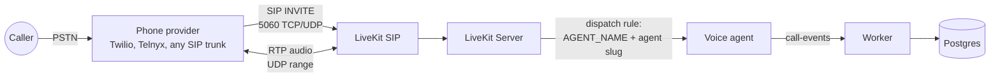

# Connect a phone number

Answerline answers phone calls through the [LiveKit SIP](https://docs.livekit.io/telephony/) service that runs next to LiveKit Server in `docker-compose.yml`. Your phone provider sends each call to the SIP service, LiveKit puts it in a room, and the agent that owns the dialed number answers it. The call is logged like a browser call, with `channel = sip`, the caller's number, and the number they dialed.

> **Status:** routing, dispatch, and caller ID are verified with simulated SIP calls against the compose stack. The Twilio and Telnyx setup scripts have not yet been run against live accounts; please report what you find.



## 1. Run the SIP service where your provider can reach it

`pnpm infra:up` starts the `sip` service along with LiveKit, sharing LiveKit's Redis. For real calls the host needs a public address, so run it on a server or VPS, or forward the ports from your router.

Open these ports to your provider:

| Port | Protocol | Purpose |
|---|---|---|
| 5060 | TCP and UDP | SIP signaling |
| `SIP_RTP_PORT_START`–`SIP_RTP_PORT_END` (default 10000–10100) | UDP | Call audio (RTP) |

Set these in `.env`, then run `docker compose up -d sip` again:

```bash
SIP_PUBLIC_IP=203.0.113.10   # the address your provider should send audio to
SIP_RTP_PORT_START=10000
SIP_RTP_PORT_END=10100       # widen for more concurrent calls
```

Without `SIP_PUBLIC_IP` behind NAT, the SIP service announces its container address and calls connect with no audio. The RTP range is small by default because Docker publishes each UDP port separately; widen it if you expect many calls at once.

Check that the service is healthy:

```bash
docker compose ps sip
docker compose logs sip
```

The logs should show `sip signaling listening on` for UDP and TCP.

The dashboard and API have no authentication yet (planned in M5). Expose only the SIP and RTP ports publicly, not the web app on port 3000.

## 2. Connect the number to an agent

Each number gets its own LiveKit inbound trunk and dispatch rule. The rule starts a room per call (`call-_<caller>_<random>`) and dispatches the agent worker named `AGENT_NAME` with the agent's slug, so one running agent process can answer for several agents.

Follow the guide for your provider. Each covers the provider-side settings, including call transfer:

- [Twilio](telephony/twilio.md): `pnpm sip twilio <number> <agent>` sets up the Elastic SIP Trunk and connects the number.
- [Telnyx](telephony/telnyx.md): `pnpm sip telnyx <number> <agent> --sip-host <host>` sets up the FQDN connection and connects the number.
- [Any other SIP trunk or PBX](telephony/sip-trunk.md): settings to enter in your provider's portal.

To manage connected numbers, use the **Phone numbers** page in the dashboard or the CLI:

```bash
pnpm sip list
pnpm sip add +15551234567 bright-smile-dental
pnpm sip assign +15551234567 front-desk
pnpm sip remove +15551234567
```

Numbers must be E.164 (`+15551234567`), matching what your provider sends as the dialed number. The CLI and dashboard use `LIVEKIT_URL`, `LIVEKIT_API_KEY`, `LIVEKIT_API_SECRET`, and `AGENT_NAME` from `.env`. `AGENT_NAME` must match the running agent's, or calls ring with no one to answer.

LiveKit's Redis stores the routing, so `lk sip inbound list` and `lk sip dispatch list` from the [LiveKit CLI](https://docs.livekit.io/home/cli/) show the same trunks and rules. Numbers that share a trunk or rule (set up by hand with `lk`) appear in the list but can only be changed with `lk`.

## 3. Call it

Call the number. The agent greets you with the agent's `greeting`. After you hang up, the call is in the `calls` table with `channel = sip`, `from_number` (the caller), and `to_number` (the number dialed).

Business hours, after-hours routing, voicemail, and booking work the same as in browser calls. Two features only work on phone calls:

- **Call transfer.** The `transfer_call` tool and after-hours `transfer` routing send a SIP REFER to your provider to connect the caller to `transfer_call.to` (E.164 number or `sip:` URI). Enable transfer (SIP REFER) on the provider's trunk: each provider guide shows how. Browser calls fall back to voicemail.
- **Caller ID.** The caller's number is stored on the call. If the caller withholds it, the provider decides what is sent (often `anonymous`).

## Troubleshooting

| Symptom | Check |
|---|---|
| Provider reports the destination unreachable | Port 5060 is open, the host or IP in the provider's settings is right, and `docker compose ps sip` is healthy |
| `docker compose logs sip` shows the INVITE was rejected | The dialed number isn't connected in the format the provider sends. Compare with `pnpm sip list` |
| Call rings but the agent never joins | The agent isn't running, or its `AGENT_NAME` differs from the one used when the number was connected. Re-run `pnpm sip assign` with the right `.env` |
| Call connects with no audio, or audio one way | `SIP_PUBLIC_IP` is unset or wrong, or the RTP UDP range is blocked |
| Transfer fails | SIP REFER isn't enabled on the provider's trunk, or the provider can't call the destination. See the provider guide |

DTMF menus and extension entry are not supported yet ([#69](https://github.com/khantseithu/answerline/issues/69)). Outbound calls are planned for M10.
